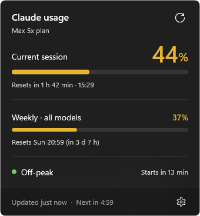
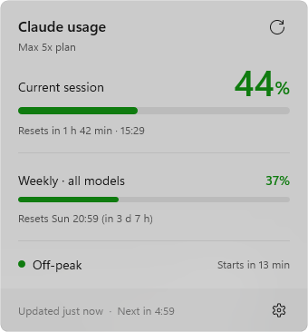
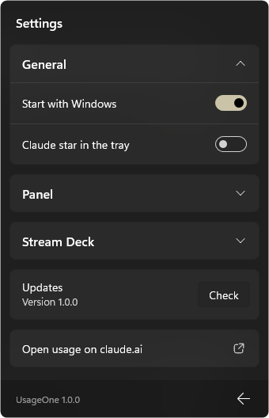

# UsageOne

Your Claude plan usage in the Windows 11 tray. A click on the icon opens a panel right above it, styled like the Windows flyouts. It shows the 5-hour session, the weekly limits, when each one resets, your plan and the peak hours.

<p>
  
  
</p>

[](https://ko-fi.com/jaizu)

## Goals

- **No API key and no sign-in.** The numbers come from [Claude Code](https://docs.claude.com/en/docs/claude-code) (`claude /usage`), using the sign-in it already has. UsageOne reads no credentials, sends nothing anywhere and spends no tokens.
- **Very light and fast.** A native app in one 0.7 MB exe, with no runtime or installer. It sits idle at almost no CPU and opens instantly (see [Performance](#performance)).
- **Looks like Windows.** Acrylic, shadow and the slide-in of the system flyouts, in light and dark theme. The bars use the Windows accent colour, white, green or a colour you pick.
- **Stream Deck plugin included.** You install it from Settings with one click.
- **Updates itself.** UsageOne checks GitHub for a new version and installs it from Settings, showing what's new.
- **Starts with Windows.** It's on from the first run and you can turn it off in Settings. If you move the exe, the startup entry follows it.
- **Keeps up with your displays.** The panel is placed on every open, so switching monitors or resolutions doesn't break it.
- **English and Spanish**, following the Windows language.

## Install

1. Download `UsageOne.exe` from the [latest release](https://github.com/Jaizu/UsageOne/releases/latest) and put it in a folder of your choice, for example `Documents\UsageOne`.
2. Run it. The mascot of Claude Code appears in the tray: white on a dark taskbar, black on a light one. Click it to open the panel. Right-click it for Refresh, Settings and Exit.

Requirements: Windows 11 and Claude Code installed and signed in with a Claude subscription (Pro or Max). If Claude Code is missing or signed out, the panel says so.

## Settings



The gear in the panel's corner opens them, in sections you can expand or collapse:

- **General**: start with Windows, and the Claude star instead of the mascot in the tray.
- **Panel**: peak hours, per-model weekly limits (only when your plan has them), and the bar colour.
- **Stream Deck**: install or update the plugin.
- **Updates**: the version, and a button to check for or install an update.

<br clear="right">

## Stream Deck

A key with the session and weekly bars, drawn like the panel (same fonts and bar colour). The footer shows when each one resets (`⟳ 40m · 1d 6h`).

- **Tap** to refresh the numbers. If UsageOne isn't running, a tap starts it.
- **Hold** to open the Claude app.

To install it, go to Settings → Stream Deck → **Install**. Stream Deck restarts to load it. Then drag **UsageOne › Claude usage** onto a key. When a UsageOne update brings a newer plugin, the same button says **Update**.

## Performance

Measured with `tools\measure.ps1` on a Windows 11 desktop:

| | |
| --- | --- |
| Exe size (with the Stream Deck plugin inside) | 716 KB |
| Start to panel on screen (first open) | ~0.35 s |
| Opening the panel again | ~9 ms (then a 0.2 s slide-in) |
| Memory at sign-in, panel not opened yet | 17 MB working set, 3 MB private |
| Memory after opening the panel | 48 MB working set, 43 MB private |
| CPU while idle | ~0.002 % |
| Stream Deck plugin | 25 MB working set, 7.5 MB private, ~0.005 % CPU |
| Reading the usage | ~1.5 s of Claude Code, every 5 minutes |

The numbers are read every 5 minutes, and when you open the panel if they are more than a minute old. Each read runs Claude Code once, in the background.

## Built with

C++20 on plain Win32: Windows.UI.Composition for the panel (acrylic, shadow, animations), Direct2D and DirectWrite for drawing, WinHTTP for updates and the Stream Deck connection. It has no frameworks and no runtime. The Stream Deck plugin is a second small native exe, built into `UsageOne.exe`.

## Build

```
build.cmd
```

It needs Visual Studio or the Build Tools with "Desktop development with C++". The script builds the plugin into `obj\`, then `bin\UsageOne.exe` with the plugin inside. `build.cmd dev` adds the development tools used by `tools\` (screenshots, measurements).

Releases come from `.github/workflows/release.yml`. When `src\version.h` has a version that isn't released yet, the workflow publishes it with its section of [CHANGELOG.md](CHANGELOG.md) as the notes.

## How it works

UsageOne runs `claude -p /usage` in the background and reads the limits it prints. It reads the plan name from Claude Code's account file (`~/.claude.json`). Nothing else is read, stored or sent. The only network requests UsageOne makes itself are the update check to GitHub and the downloads of updates.
